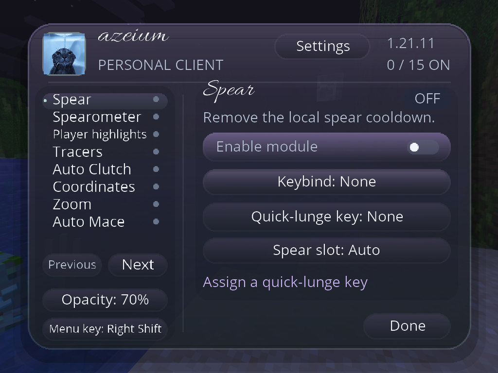

# Azeium 2.4.0

Minecraft Java 1.21.11 · Fabric Loader 0.19.3+ · Java 21 · Fabric API.

- [Release downloads: JAR, source, README and offline website ZIP](https://github.com/azesociety/my-codings-/releases/tag/v2.4.0)
- [Download the mod JAR](https://github.com/azesociety/my-codings-/raw/refs/heads/main/azeium-2.4.0-mc1.21.11.jar)
- [Download the source ZIP](https://github.com/azesociety/my-codings-/raw/refs/heads/main/azeium-2.4.0-source.zip)
- [Browse the source project](lunge-test-client/)
- [Installation and controls](AZEIUM-README.md)

Replace the older Azeium JAR in your instance's mods folder. Build the source
with Java 21 using `gradlew.bat build` (Windows) or `./gradlew build` (Linux/macOS)
inside `lunge-test-client`. The first build downloads dependencies.

New: shared satin glass redesign with licensed Allura cursive headings,
Performance HUD for live FPS and reported ping, and Disable all modules.
Existing same-click Smash, slot return, keyboard/mouse spear shortcuts and
optional local reach settings are retained. Server rules determine valid hits.

Forward lunges require the Lunge enchantment and normal vanilla conditions.

## Previous repository README

# my-codings-
Here i put in my supercool code ig
